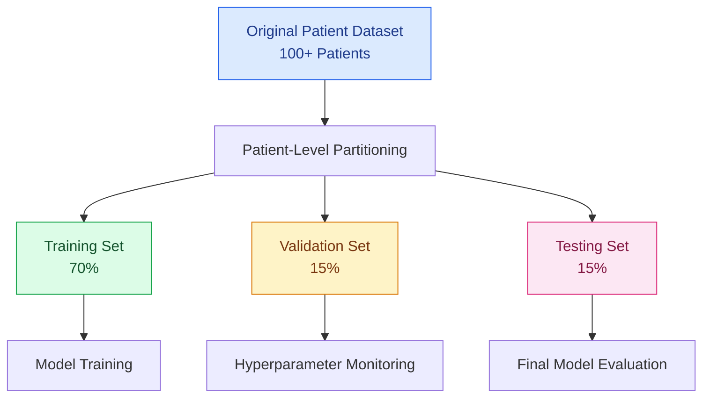
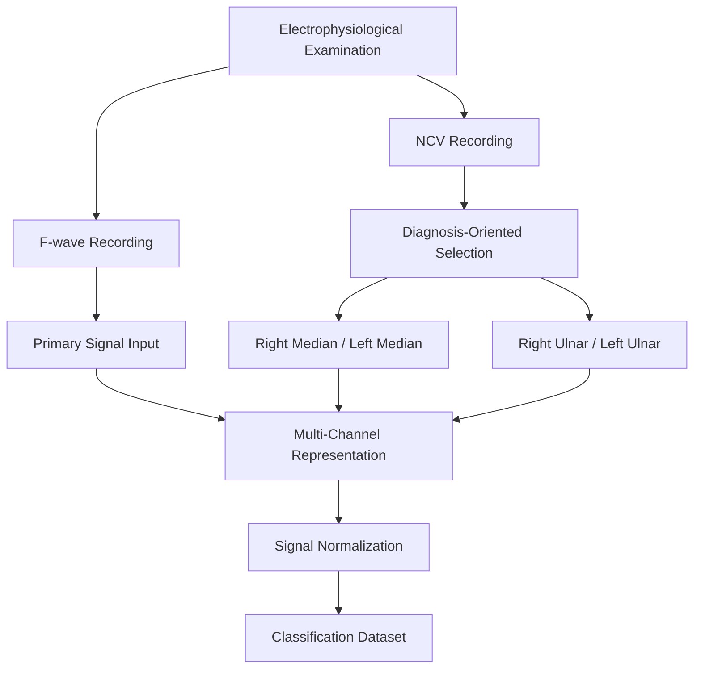
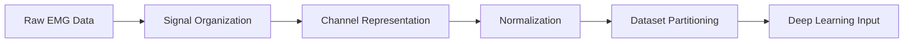
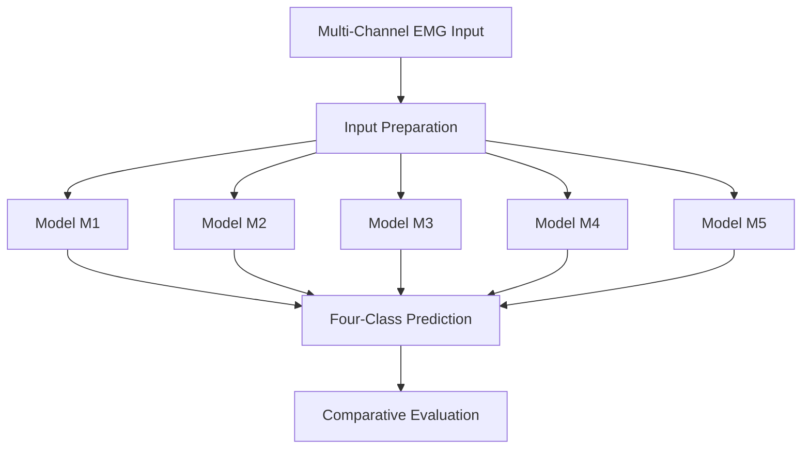
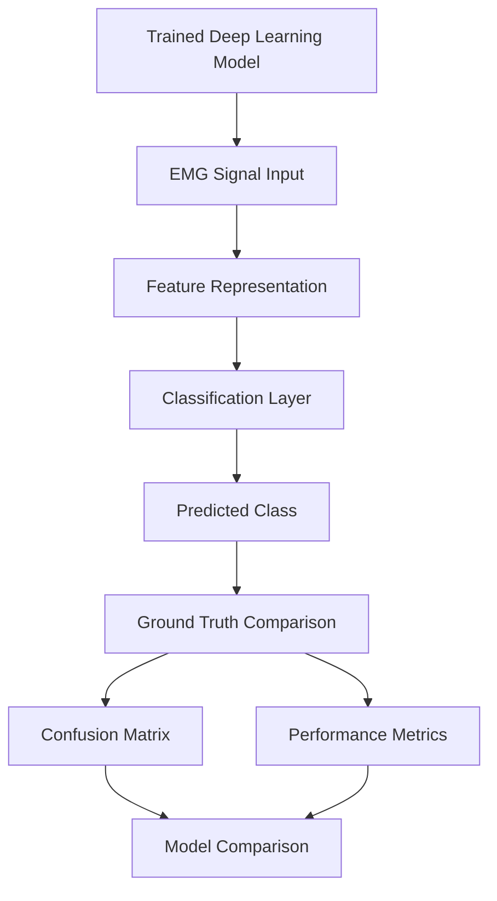

# 🧠 Four-Class EMG Signal Classification Using Deep Learning

  <strong>A Deep Learning-Based Framework for Neuromuscular Signal Analysis and Classification</strong>

  
  
  
  
  

---

## 1. Research Overview

This research investigates the application of deep learning techniques for automated classification of Electromyography (EMG) signals into four distinct diagnostic classes.

The study focuses on extracting discriminative information from neuromuscular electrical activity through multi-channel signal representation and comparative deep learning experiments.

The proposed framework incorporates:

- Multi-channel EMG signal representation.
- F-wave as the primary electrophysiological examination.
- Diagnosis-oriented Nerve Conduction Velocity (NCV) signal selection.
- Patient-level dataset partitioning.
- Comparative evaluation of five deep learning models.
- Quantitative performance assessment for four-class classification.

The primary objective is to investigate how deep learning models can identify different neuromuscular patterns from electrophysiological signals.

## 2. Research Dataset

The experimental dataset consists of EMG-related electrophysiological recordings collected from more than 100 patients.

| Dataset characteristic | Description |
|---|---|
| Data modality | Electrophysiological signals |
| Primary examination | F-wave |
| Additional examination | NCV |
| Classification task | Four classes |
| Signal representation | Five-channel representation |
| Patient population | More than 100 patients |
| Data normalization | Applied |
| Data splitting | Patient-level partitioning |

### Dataset Distribution

The dataset is divided using a patient-level partitioning strategy to minimize data leakage between training, validation, and testing subsets.

*Note: The percentages refer to patient-level allocation, not individual signal segments.*

## 3. Electrophysiological Signal Processing

The research utilizes F-wave and NCV recordings as complementary sources of electrophysiological information.

### Signal Acquisition Strategy

### Signal Processing Pipeline

The preprocessing stage focuses on preparing the electrophysiological recordings for deep learning analysis.

The preprocessing strategy is designed to preserve the original electrophysiological information while ensuring consistent input representation for model training.

## 4. Proposed Deep Learning Framework

Five model configurations (M1–M5) are investigated to provide a comparative analysis of deep learning performance.

### Model Comparison

| Model | Configuration | Purpose |
|---|---|---|
| M1 | Deep Learning Model 1 | Baseline experiment |
| M2 | Deep Learning Model 2 | Comparative experiment |
| M3 | Deep Learning Model 3 | Comparative experiment |
| M4 | Deep Learning Model 4 | Comparative experiment |
| M5 | Deep Learning Model 5 | Comparative experiment |

*The exact architecture names and layer configurations will be documented according to the final experimental implementation.*

### Training Configuration

| Parameter | Configuration |
|---|---|
| Number of models | 5 |
| Maximum training epochs | 1,000 |
| Classification output | 4 classes |
| Data normalization | Applied |
| Training split | 70% |
| Validation split | 15% |
| Testing split | 15% |
| Data partitioning | Patient-level |

## 5. Classification and Evaluation

The framework evaluates the capability of each model to distinguish the four electrophysiological classes.

The evaluation stage focuses on:

- Accuracy
- Precision
- Recall (Sensitivity)
- Specificity
- F1-score
- Confusion matrix
- Class-wise classification performance

### Classification Workflow

### Confusion Matrix

A confusion matrix is used to evaluate the classification performance across all four classes.

*The actual numerical results will be populated from the final testing experiments.*

  <strong>Biomedical Signal Processing | Electrophysiology | Deep Learning | EMG Classification</strong>

